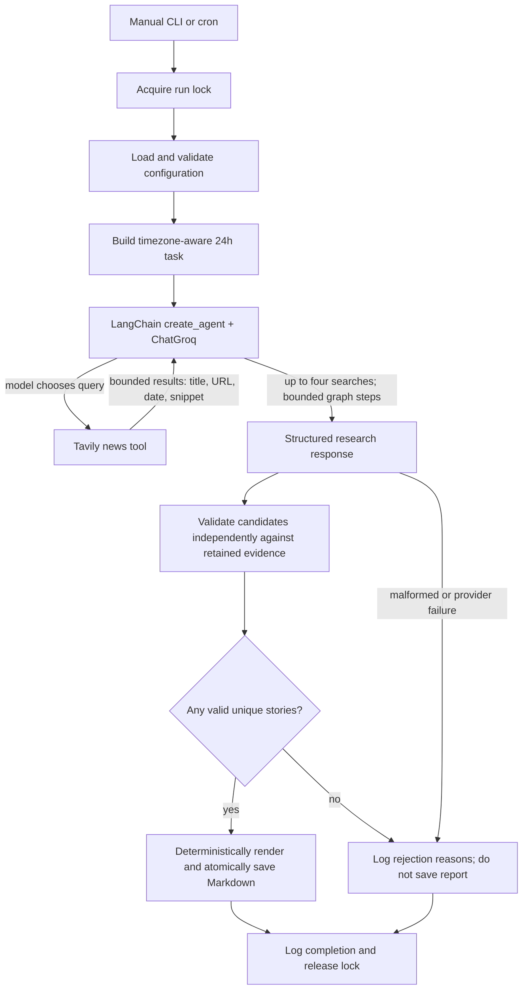

# Architecture

## Components

| Component | Responsibility |
|---|---|
| `main.py` | CLI, lock, run lifecycle, error handling, exit status, logs |
| `config.py` | Environment and `.env` loading, validated immutable settings, timezone/window |
| `agent.py` | `ChatGroq`, `create_agent`, usage callback, safe provider diagnostics, research task, step bound |
| `tools.py` | Tavily setup, per-run search counter, result normalization and response-size ceiling |
| `prompts.py` | Analyst role, research and evidence rules, structured-output contract |
| `report.py` | Typed story schema, per-item evidence validation, deterministic Markdown rendering, collision-safe UTF-8 save |
| `scheduler/` | Linux cron wrapper and safe example entry |
| `tests/` | Deterministic behavior tests with provider calls mocked |

## Data flow and lifecycle

1. CLI acquires a lock, loads configuration, initializes structured console/file logging, and calculates the local report date and rolling research window.
2. The agent receives the system instructions and exact UTC-offset-bearing interval. `create_agent` handles the model → tool → model cycle.
3. The single exposed tool is a wrapper around Tavily. The wrapper atomically counts calls and refuses calls beyond the configured limit. It keeps at most three results, only title/URL/publication date/snippet fields, snippets of at most 300 characters, and at most 6,000 serialized UTF-8 bytes. The graph recursion limit provides a separate upper bound on model/tool transitions.
4. Search results contain titles, URLs, publication dates when provided, and snippets. Malformed entries are skipped, and unknown publication dates remain absent. Result content is treated as untrusted evidence. The model must not execute or obey text found within results.
5. LangChain's tool-based structured-output strategy returns typed story candidates without a separate formatting call. Malformed structured output fails closed. Each candidate is checked independently for required fields, retrieved valid URLs, duplicate stories, publication-date support, and the existing numerical/technical/summary evidence safeguards.
6. Invalid candidates are logged by bounded reason code. Valid unique candidates remain eligible; if none pass, no report is written. Markdown is rendered from validated objects and atomically saved to a unique date-based destination.

## Error handling

Configuration errors, missing keys, provider errors, rate limits, timeouts, agent step exhaustion, empty/malformed final output, and filesystem errors are logged with run metadata. A LangChain callback counts model calls and aggregates available `AIMessage.usage_metadata` token totals. Failed calls may have no usage metadata, so logs mark token totals incomplete. HTTP status, allow-listed rate-limit/reset headers, retry-after, structured error codes, and connection-reset classification are logged without request content or credentials. A generic 429 is labeled unknown throttling unless body/header evidence identifies a dimension. The original provider error remains exception-chained. Groq requests use the configured timeout and one bounded provider retry; the whole agent is never restarted. The current `langchain-tavily` tool does not expose a timeout constructor field; its wrapped API client supplies its own request timeout.

## Scheduling and overlap

The scheduler invokes `python -m main` via a project-root-resolving shell wrapper and `flock`. The application lock also protects manual invocations where `fcntl` is available. Cron's timezone is the host's timezone unless the crontab sets `CRON_TZ`; documentation shows explicit Asia/Karachi configuration. The actual crontab is never edited by the project.

## Configuration and security boundaries

Secrets come only from `GROQ_API_KEY` and `TAVILY_API_KEY` in the environment or ignored `.env`. No key is logged. Config values are validated and bounded. The agent only receives Tavily; it has no filesystem, shell, or arbitrary-code tool. Retrieved text cannot change system/developer constraints.

## Future extensibility

The modules keep provider setup, research orchestration, report rendering, and entry-point lifecycle separate. A later project can add other agents by composing separate modules, but this repository intentionally contains only Agent 1.
